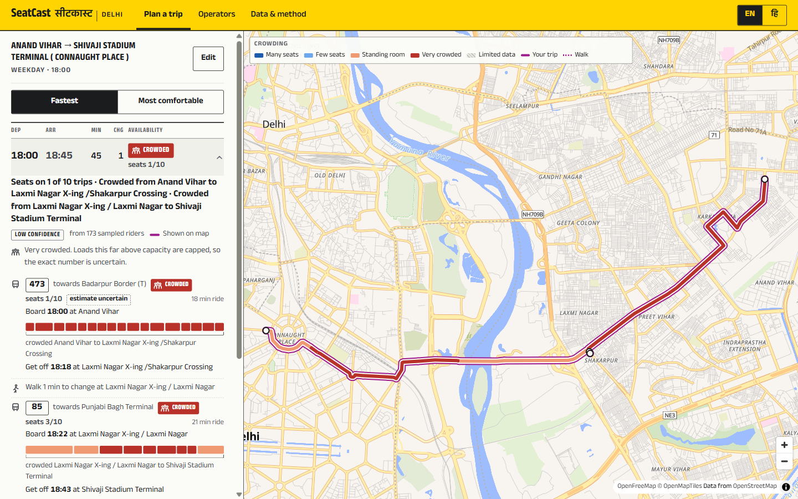
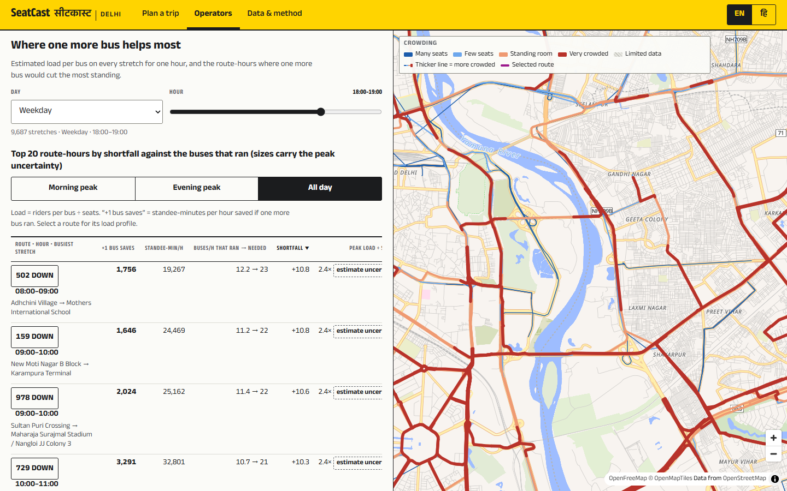
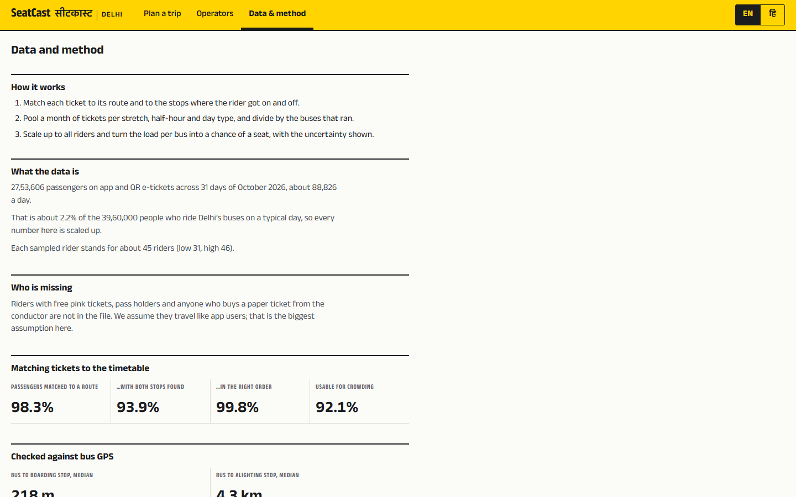
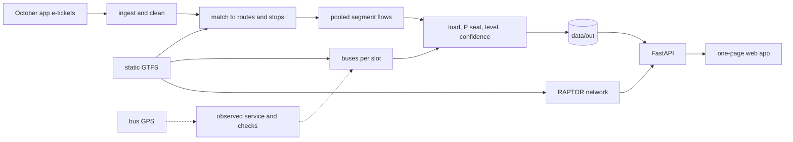

# SeatCast Delhi

**How crowded is my bus, really?** SeatCast estimates how crowded Delhi's buses usually are, stretch by stretch and half-hour by half-hour, and shows it next to every journey option with its travel time. A commuter can then trade minutes for a seat. The same estimates show operators where one more bus would remove the most standing.

Built for the **Delhi Transport Stack Hackathon 2026, Problem 2** (crowdedness-aware journey planner).



## What's inside

- **A rerunnable pipeline** from one month of e-tickets to crowding estimates by route, direction, stretch, 30-minute slot and day type (weekday, Saturday, Sunday or holiday).
- **A journey planner** (RAPTOR on the official static GTFS) that ranks options by time or by crowding-weighted time. It adds suggestions such as "leave at 18:20 → likely seat".
- **An operator view:** a segment heatmap by hour and a "+1 bus" ranking of route-hours by standee-minutes saved.
- **Ground truth from GPS:** where each bus was when tickets were bought, and how many trips actually ran.
- **One bilingual page** (English / हिन्दी) and an OpenAPI at `/docs`.

## Screens

| Operators: where one more bus helps most | Data and method: coverage and GPS checks |
|---|---|
|  |  |

## Quick start

Needs Python 3.12+. It was tested on Python 3.13 under Windows 11 on a laptop with 16 GB of RAM.

```bash
python -m venv .venv
source .venv/bin/activate          # Windows: .venv\Scripts\activate
pip install -r requirements.txt    # also installs this package in editable mode
```

Place the data. It is not in the repo: it is licensed for the hackathon, and `data/` is git-ignored.

| File | Where it goes | Source |
|---|---|---|
| `October-Delhi.csv` (unzip `October-Delhi.csv.zip`) | `data/raw/tickets/` | Hackathon organisers (data README) |
| Static GTFS: `agency, calendar, routes, trips, stop_times, stops, shapes, feed_info` (`.txt`) | `data/raw/gtfs/` | [Delhi Transport Stack](https://delhi.transportstack.in/data-services/datadetails/1): sign in, then **Download** and fill in the request form |
| `delhi-dtc-bus-gtfs-rt-2026-10.7z` (optional, 16 GB) | `data/raw/gps/` | Hackathon organisers (data README); needs 7-Zip |

Build everything and serve:

```bash
python -m seatcast.run all        # day0 → ingest → match → flows → load → checks → note (about 5 min)
python -m seatcast.run gps        # optional, needs the 16 GB archive: rebuilds the GPS checks and delivery ratios
python -m seatcast.run serve      # http://127.0.0.1:8000  (API docs at /docs)
```

Without the GPS archive, `run all` uses the shipped GPS aggregates in `config/` (bus delivery ratios and check summaries, no vehicle data) and reproduces the published numbers. On Unix, `make all && make serve` does the same. Each step also runs on its own, for example `python -m seatcast.run match`.

Try these:
- the page opens on **Anand Vihar ISBT → Connaught Place, 18:00 weekday** (the judges' example)
- **Kashmere Gate ISBT → Nehru Place, 08:30 weekday**
- from the command line: `python -m seatcast.run plan "Anand Vihar ISBT" "Connaught Place" 18:00 weekday`

## How it works



1. **The file is app e-tickets only.** 99.3% of passengers paid exactly 90% of a standard fare slab, which is Delhi's app discount. That is about 2% of all riders, so we never count passengers per trip.
2. **Pool and expand.** A month of tickets gives the mean daily flow f on each stretch and slot. Load per bus is **L = E · f / N**, where N is the buses running and E scales app riders to all DTC and cluster riders.
3. **Uncertainty becomes a seat chance.** Sampling, day-to-day and bus-to-bus variation give P(seat), shown as "seats on 7 of 10 trips". Stretches with fewer than 5 sampled riders say "limited data".
4. **Checked against ground truth.** The GPS feed confirms where the bus was at ticket time and how many trips really ran. Distances travelled rise with the fare slab paid.
5. **Shown for a one-second read.** GTFS-Realtime crowding levels, a stop-by-stop strip on every bus leg, and a colour-blind-safe scale that never relies on colour alone.

More detail:
- [docs/PROPOSAL.md](docs/PROPOSAL.md): the proposal.
- [docs/THINKING.md](docs/THINKING.md): decisions and evidence.
- [docs/IMPLEMENTATION_PLAN.md](docs/IMPLEMENTATION_PLAN.md) and [docs/phases/](docs/phases/): the build plan.
- [docs/TECH_NOTE.md](docs/TECH_NOTE.md): the technical note, every number generated from the outputs.
- [docs/CHECKS.md](docs/CHECKS.md): validation report with charts.
- [docs/DAY0.md](docs/DAY0.md): what the ticket file contains.

## Repository layout

```
config.yaml              every threshold and assumption, labelled
config/                  route map, stop aliases (reviewed or GPS-evidenced), bus capacities
src/seatcast/            io, clean, match, gtfs, service, flows, load, checks, raptor, plan, api, run
web/                     the page: index.html, app.js, data.js, i18n.js, style.css
tests/                   unit tests on toy feeds, plus data checks that run when data/ is present
docs/                    proposal, thinking, plan, phase docs, generated reports
```

## Tests

```bash
pytest -q
```

- **Unit tests** run on small hand-made feeds.
- **Data checks** (`tests/test_data.py`) test every pipeline step's real outputs: completeness, invariants, privacy and the demo query. They skip automatically when `data/` is absent.
- **CI** (GitHub Actions) runs lint, the tests, and guards against committed data or vehicle plates on every push.

## Privacy

- Tickets carry no personal identifiers.
- Vehicle numbers are used only internally, for the bus-capacity mix and GPS matching, and never appear in published outputs, the API or the page.
- Any estimate built from fewer than 5 sampled passengers is withheld.
- Only aggregates are published.

## Credits

- **Data:** Delhi Transport Department and the Transport Stack hackathon organisers (e-tickets, GTFS, GPS).
- **Open-source software:** DuckDB, pandas, NumPy, PyArrow, RapidFuzz, FastAPI, Uvicorn, MapLibre GL JS, with OpenFreeMap tiles (© OpenMapTiles, data © OpenStreetMap contributors).
- **AI assistance:** developed with help from Claude Code (Anthropic), as the hackathon rules require AI tools to be credited.

## Licence

Code: MIT, see [LICENSE](LICENSE). Data belongs to its providers (Transport Department, GNCTD / Delhi Transport Stack) and is not in this repository; the aggregates in `config/` and the published outputs are shared with the source acknowledged.
