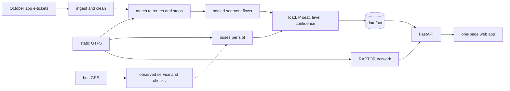

# SeatCast Delhi

[](https://github.com/sahilsahu4102/SeatCast/actions/workflows/ci.yml)
[](LICENSE)

**How crowded is my bus, really?** SeatCast estimates how crowded Delhi's buses usually are, stretch by stretch and half-hour by half-hour. It shows that estimate next to every journey option, beside its travel time, so a commuter can trade a few minutes for a seat. The same estimates show bus operators where one more bus would remove the most standing.

Built for the **Delhi Transport Stack Hackathon 2026, Problem 2** (crowdedness-aware journey planner).

### ▶ [Watch the 3-minute demo video](https://youtu.be/QW0uWUYJfwQ)


> **Submission documents:** [Demo video](https://youtu.be/QW0uWUYJfwQ) · [Proposal (PDF)](docs/SeatCast_Proposal.pdf) · [Technical note (PDF)](docs/SeatCast_Technical_Note.pdf) · [Validation report](docs/CHECKS.md) · [Demo script](docs/DEMO_SCRIPT.md)

---

## Contents

1. [The idea in one minute](#the-idea-in-one-minute)
2. [Results at a glance](#results-at-a-glance)
3. [What you can do with it](#what-you-can-do-with-it)
4. [Quick start](#quick-start)
5. [How it works](#how-it-works)
6. [How we know it is right](#how-we-know-it-is-right)
7. [What it cannot do (yet)](#what-it-cannot-do-yet)
8. [API](#api)
9. [Repository guide](#repository-guide)
10. [Tests and CI](#tests-and-ci)
11. [Privacy](#privacy)
12. [Troubleshooting](#troubleshooting)
13. [Team](#team)
14. [Credits and licence](#credits-and-licence)

---

## The idea in one minute

**The problem.** Journey planners tell you the fastest bus. In Delhi, whether you will get a seat often matters just as much, but nobody publishes how full the buses are.

**The data we have.** One month (October 2026) of e-tickets: 2.56 million tickets for 2.75 million passengers, each with a route, a boarding stop, a destination stop and a time.

**The catch.** Almost every ticket was bought at the app price (90% of the normal fare), so the file holds only **app tickets**. That is about **2 in every 100 riders**. On a single bus on a single day, that is only a handful of tickets, far too few to count how full that bus was.

**What we do instead.**
1. **Pool.** We add up a whole month of tickets for each stretch of road (stop to stop), each half-hour and each day type. Thousands of tickets together give a reliable *pattern*, even though one bus gives almost nothing.
2. **Scale up.** We multiply by how many real riders each app rider stands for (about 45).
3. **Divide by the buses that actually ran.** The bus GPS shows that about 62% of the timetabled bus-kilometres actually ran on weekdays, so we use that real count, not the timetable.
4. **Turn it into a seat chance.** We compare the load with the seats on that bus type and say it plainly: *"seats on 7 of 10 trips"*.

**The answer, for the judges' example** (Anand Vihar → Connaught Place, 18:00 weekday): the fastest trip (473 + 85, 45 min) is packed from Anand Vihar to Laxmi Nagar, with a seat on about 2 trips in 10. Leaving 10 minutes later on the 39A arrives just 6 minutes later with a seat on nearly every trip. The page also suggests walking back to Yamuna Sport Complex to board upstream.

---

## Results at a glance

Every number below is generated by the pipeline (see [docs/TECH_NOTE.md](docs/TECH_NOTE.md) and [docs/CHECKS.md](docs/CHECKS.md)); none is typed by hand.

| What | Result |
|---|---|
| Ticket passengers matched to a GTFS route | **98.35%** |
| Route-matched passengers with both stops matched | **93.89%**, of which **99.78%** are in travel order |
| Digital passengers represented in the crowding model | **97.61%** |
| Bus distance from the matched boarding stop when the ticket was bought (GPS) | median **218 m** (vs 4,308 m from the alighting stop) |
| Hold-out: weeks 1–3 predict week 4's crowding level within one step | **95.0%** of cells (noise ceiling 97.0%); high-confidence cells **97.9%** |
| Timetabled bus-km that actually ran (GPS, weekdays) | **62%** |
| Weekday peaks of boardings | 9:00 and 18:00; quietest hour 14:00 |
| Weekday loads higher than Sunday loads | in **75.6%** of shared cells |
| Confidence of published cells | high 26.3% · medium 43.6% · low 30.0% |
| Bus-to-bus variation (bunching), measured from 1.9 million GPS headway degrees of freedom | median **0.62** (we had assumed 0.35) |
| Sensitivity: levels that change if capacity is ±15% / E is low | 15–18% / 37%, always by one step at most |
| Levels that would change using the timetable instead of GPS-observed buses | **40%** |
| Outside check: TMS ring route against a published on-bus passenger count | same shape: peak at AIIMS, fall, rise after Dhaula Kuan |

---

## What you can do with it

**Commuters (Planner tab)**
- Pick a start and end stop (type to search, or click the map), a time and a day type.
- Get up to 3 options. Each shows its departure, arrival, minutes, changes and a crowding chip (*Many seats / Few seats / Standing room / Very crowded / Limited data*). The chip shows a word and an icon as well as a colour, so it never relies on colour alone.
- Every bus leg has a **stop-by-stop strip**, so "crowded on the middle stretch" is visible at a glance.
- Suggestions such as **"Leave at 18:20 → likely seat"** or **"Board one stop earlier"**, and a comparison with 11:00, the quiet hour.
- Switch between **Fastest** and **Comfort**. Comfort counts a standing minute as more costly than a seated one.

**Operators (Operators tab)**
- A **map heatmap** of how full each stretch is, for any hour and day type.
- The **top 20 route-hours** where one more bus would remove the most standing (standee-minutes saved), with the buses running vs the buses needed.

**Everyone (Data tab)**
- What the data is, who is missing from it, the match rates and the GPS checks, in plain language.

The whole page is in **English and Hindi** (हिन्दी) and works on a phone.

| Operators: where one more bus helps most | Data and method: coverage and GPS checks |
|---|---|
|  |  |

---

## Quick start

### 1. Install

You need Python 3.12 or newer. It was tested on Python 3.13, Windows 11, on a laptop with 16 GB of RAM.

```bash
git clone https://github.com/sahilsahu4102/SeatCast.git
cd SeatCast
python -m venv .venv
source .venv/bin/activate          # Windows: .venv\Scripts\activate
pip install -r requirements.txt    # also installs this package in editable mode
```

### 2. Add the data

The data is **not in this repository**: it is licensed for the hackathon, and `data/` is git-ignored.

| File | Put it in | Where to get it |
|---|---|---|
| `October-Delhi.csv` (unzip `October-Delhi.csv.zip`) | `data/raw/tickets/` | Hackathon organisers (data README) |
| Static GTFS `.txt` files: `agency, calendar, routes, trips, stop_times, stops, shapes, feed_info` | `data/raw/gtfs/` | [Delhi Transport Stack](https://delhi.transportstack.in/data-services/datadetails/1): sign in, click **Download**, and fill in the request form |
| `delhi-dtc-bus-gtfs-rt-2026-10.7z` (*optional*, 16 GB) | `data/raw/gps/` | Hackathon organisers (data README); unpack it with 7-Zip |

The GPS archive is optional. Without it, the pipeline uses the small GPS summaries shipped in `config/` (bus delivery ratios and check results, no vehicle data), and still reproduces every published number.

### 3. Build and run

```bash
python -m seatcast.run all        # whole pipeline, about 5 minutes
python -m seatcast.run serve      # open http://127.0.0.1:8000  (API docs at /docs)
```

On Linux or macOS, `make all && make serve` does the same.

### 4. Try it

- The page opens on **Anand Vihar (main road) → Connaught Place, 18:00, weekday** (the judges' example).
- Try **Kashmere Gate ISBT → Nehru Place, 08:30, weekday**.
- From the terminal:
  ```bash
  python -m seatcast.run plan "Anand Vihar ISBT" "Connaught Place" 18:00 weekday
  ```

### Pipeline steps

`run all` runs the steps below in order. Each one can also be run alone, for example `python -m seatcast.run match`.

| Step | What it does | Main output |
|---|---|---|
| `day0` | Checks what the ticket file really contains (fares, zero fares, days, vehicles) | `docs/DAY0.md` |
| `ingest` | Loads and cleans tickets: parses route codes, cleans stop names, sorts fares, tags day types and odd days | `data/work/tickets.parquet` |
| `match` | Matches routes and stops to the GTFS and checks the direction of travel | `data/work/od.parquet`, match rates |
| `flows` | Spreads each ticket over the stretches it rides and averages per half-hour and day type | `data/work/flows.parquet` |
| `load` | Scales up, divides by buses that ran, and adds seat chance, level and confidence | `data/out/cells.parquet`, `segments.geojson`, `operator.parquet` |
| `checks` | Validation report with charts | `docs/CHECKS.md`, `docs/img/*.png` |
| `note` | Fills the technical note with the computed numbers | `docs/TECH_NOTE.md` |
| `gps` *(optional)* | Rebuilds GPS checks and delivery ratios from the 16 GB archive | `config/service_scale.csv`, `gps_checks.json` |

---

## How it works



### The crowding model in plain words

The unit is a **cell**: one route, one direction, one stretch between two stops, one 30-minute slot and one day type (weekday, Saturday, or Sunday/holiday).

| Symbol | Meaning | How we get it |
|---|---|---|
| **f** | App passengers on that stretch in that slot, on an average day | Each ticket rides from its boarding stop to its alighting stop; sum them over the month and divide by the number of days |
| **E** | How many real riders one app rider stands for | Daily DTC + cluster riders ÷ daily app riders = **44.58** (range 31.21–45.93) |
| **N** | Buses that actually ran in that slot | Timetable buses × the GPS delivery ratio for that route, day type and hour band |
| **L** | Average load of one bus | **L = E × f ÷ N** |
| **P(seat)** | Chance a seat is free when you board | Load varies bus to bus (bunching, day to day); we model that spread and ask how often the load stays below the seats |

The load is then compared with the bus's seats and turned into a level, using the standard GTFS-Realtime occupancy vocabulary:

| Load ÷ seats | Level shown |
|---|---|
| under 0.5 | **Many seats** |
| 0.5 to 1.0 | **Few seats** |
| 1.0 up to full capacity | **Standing room** |
| above full capacity | **Very crowded** |
| fewer than 5 sampled riders | **Limited data** (never estimated) |

Each cell also gets a **confidence badge**. *High* needs at least 30 sampled riders and a pattern that stays the same from week to week; *medium* needs at least 10.

Cells where the estimate is far above what a bus can physically hold (more than 1.5× full capacity) are shown as **Very crowded, estimate uncertain**: the level is sure, but the exact number is not.

### The planner

- **Routing.** RAPTOR, a standard fast public-transport routing algorithm, runs over the official static GTFS. It allows walking to nearby stops and up to 2 changes.
- **Crowding per leg.** For each bus leg the planner gives the seat chance at boarding, the minutes you are likely to stand, the worst level, and the stretch where the bus is crowded.
- **Comfort ranking.** Options are scored by *generalised time*, where a standing minute counts 2.35× and a seated minute about 1×, following published crowding research (Wardman & Whelan 2011). Walking, waiting and changes are also weighted.

### The operator view

For each route and hour we find the most-loaded stretch, the buses needed to keep it at 80% of capacity, the buses actually running, and the **standee-minutes one extra bus would remove**. The 20 route-hours with the biggest benefit are listed first.

All thresholds and assumptions live in [config.yaml](config.yaml), each one labelled.

---

## How we know it is right

| Check | What it shows |
|---|---|
| **GPS at ticket time** | The bus was a median 218 m from the boarding stop we matched, and 4.3 km from the alighting stop. So the ticket time is the boarding time, and the stop matching is right. |
| **Hold-out forecast** | A model built from weeks 1–3 only predicts week 4's level within one step on 95.0% of cells. Pure sampling noise allows 97.0%, so we are close to the limit. |
| **Fares vs distance** | Distance travelled rises with the fare slab paid, an independent check of the stop matching. |
| **Known patterns** | Morning and evening peaks, weekdays busier than Sundays, and 9 of the 10 most crowded route-hours in peak windows. |
| **Service reality** | GPS shows 62% of timetabled weekday bus-km actually ran; using the timetable alone would understate crowding. |

The full validation, with charts, is in [docs/CHECKS.md](docs/CHECKS.md). That report also covers a calibration we tried and rejected, and why.

---

## What it cannot do (yet)

We say these limits openly in the app and in the technical note:

- **Peak sizes are inflated.** App users travel more in the peaks than riders overall, so one city-wide scale factor overstates peak loads. The *level* (crowded or not) is robust; the exact number at the peak is not. The fix is hourly route totals from the conductors' ticket machines (ETM), which we have asked the organisers for.
- **Some riders are missing.** Free riders (women with the Pink pass) and pass holders are not in the file. We assume they travel like app riders.
- **Bus capacities are not verified.** They come from fleet announcements until a fleet register is available.
- **Usual, not live.** These are typical conditions for that time and day type, not a live count of the bus in front of you.
- **Night hours** have few tickets, so most of their cells are low confidence.

---

## API

The server is FastAPI. Interactive docs are at `/docs` once it is running.

| Endpoint | Returns |
|---|---|
| `GET /health` | `{"ok": true}` |
| `GET /stops?q=<text>` and `GET /stops/all` | Stop search, and the compact stop list for in-browser search |
| `GET /journeys?from=&to=&depart=YYYY-MM-DDTHH:MM&daytype=&pref=fastest\|balanced\|comfort` | Up to 3 options with crowding per leg, suggestions and the quiet-hour line |
| `GET /crowding/route/{base}/{dir}?daytype=&time=` | Per-stretch load, range, level, seat chance, confidence and sample size |
| `GET /crowding/heatmap?daytype=&hour=` | GeoJSON stretches with load factor and level |
| `GET /operator/top?daytype=&period=am\|pm\|all` | Ranked route-hours: buses needed vs running, standee-minutes, +1-bus benefit |
| `GET /coverage` | Match rates, expansion factor, odd days and data notes |

---

## Repository guide

```
config.yaml              every threshold and assumption, labelled
config/                  route map, stop aliases (reviewed or GPS-evidenced), bus capacities, GPS summaries
src/seatcast/            the code, one small module per step (see below)
web/                     the page: index.html, app.js, data.js, i18n.js (English + Hindi), style.css
tests/                   unit tests on toy feeds, plus data checks that run when data/ is present
scripts/                 day-0 SQL, PDF export, optional Hugging Face deploy
docs/                    proposal, technical note, checks, plan, thinking, phase docs
```

| Module | Job |
|---|---|
| `io.py` | Load tickets and GTFS; day-0 checks |
| `clean.py` | Route-code parser, stop-name cleaner, fare classes, day types, odd days |
| `match.py` | Route, direction and stop matching |
| `gtfs.py`, `service.py` | Stop patterns, buses per slot, run times |
| `flows.py` | Stretch-by-stretch flows per slot |
| `load.py` | Expansion, loads, seat chance, levels, confidence, operator table |
| `checks.py` | Validation report, GPS checks, technical-note filling |
| `raptor.py`, `plan.py` | Router and journey options with crowding |
| `api.py`, `run.py` | Web API and command line |

**Documents**

| Document | What it is |
|---|---|
| [docs/PROPOSAL.md](docs/PROPOSAL.md) ([PDF](docs/SeatCast_Proposal.pdf)) | The proposal |
| [docs/TECH_NOTE.md](docs/TECH_NOTE.md) ([PDF](docs/SeatCast_Technical_Note.pdf)) | Method, assumptions, validation and limits; every number generated |
| [docs/CHECKS.md](docs/CHECKS.md) | Validation report with charts |
| [docs/FINDINGS.md](docs/FINDINGS.md) | Operator brief with five computed findings and charts |
| [docs/DAY0.md](docs/DAY0.md) | What the ticket file actually contains |
| [docs/DEMO_SCRIPT.md](docs/DEMO_SCRIPT.md) | Step-by-step demo |
| [docs/THINKING.md](docs/THINKING.md) | Decisions and the evidence behind them |
| [docs/IMPLEMENTATION_PLAN.md](docs/IMPLEMENTATION_PLAN.md), [docs/phases/](docs/phases/) | The build plan |

---

## Tests and CI

```bash
pytest -q
```

- **Unit tests** run on small hand-made feeds: the route parser, the stop cleaner, the flow count on a toy route, the seat-probability maths, the router and every API endpoint.
- **Data checks** (`tests/test_data.py`, plus 3 API tests) test the real pipeline outputs: completeness, invariants, privacy, and that the demo query works fast.
- **CI** (GitHub Actions) runs lint and the tests on every push. It also fails the build if any data file or anything that looks like a vehicle number plate gets committed.

**Why CI shows 19 skipped tests.** The data checks need `data/`, which is never committed. On a clean clone, and in CI, those 19 tests skip themselves with the message "needs pipeline data". With the data in place, the full suite runs: **120 passed, 0 skipped**.

---

## Privacy

- Tickets carry no personal identifiers.
- Vehicle numbers are used only inside the pipeline (bus-type mix and GPS matching). They never appear in outputs, the API or the page, and tests scan for them.
- Any estimate built from fewer than 5 sampled passengers is withheld and shown as "limited data".
- Only aggregates are published, consistent with India's DPDP Rules 2025.

---

## Troubleshooting

| Problem | Fix |
|---|---|
| `FileNotFoundError` for the tickets or GTFS | Check the file names and folders in [Add the data](#2-add-the-data). Unzip the ticket file first. |
| The pipeline is slow or the PC runs out of memory | Close other heavy programs. DuckDB is capped at 4 GB, and steps can be run one at a time. |
| Port 8000 is already in use | Stop the other server, or run `python -m uvicorn seatcast.api:app --port 8001`. |
| The map is blank | The map tiles come from OpenFreeMap over the internet; check the connection. Planning still works. |
| 19 tests are skipped | Expected without `data/`; see [Tests and CI](#tests-and-ci). |

---

## Team

| Member | GitHub | Role |
|---|---|---|
| Sahil Kumar Sahu | [@sahilsahu4102](https://github.com/sahilsahu4102) | Data pipeline, crowding model, journey planner, API and web app |
| Sucharita Chattopadhyay | [@Sucharita2006](https://github.com/Sucharita2006) | Research and problem framing; data checks (what the ticket file is, stop-name matches); testing the planner and finding bugs; UI, design and Hindi text; proposal and technical note; demo video review; registration and organiser contact |

---

## Credits and licence

- **Data:** Transport Department, GNCTD, and the Delhi Transport Stack hackathon organisers (e-tickets, GTFS, GPS).
- **Open-source software:** DuckDB, pandas, NumPy, PyArrow, RapidFuzz, FastAPI, Uvicorn and MapLibre GL JS, with OpenFreeMap tiles (© OpenMapTiles, data © OpenStreetMap contributors).
- **AI assistance:** developed with help from Claude Code (Anthropic) and GitHub Copilot; the demo narration uses Chatterbox TTS and the music ACE-Step. Credited as the hackathon rules require.

**Licence.** The code is MIT-licensed ([LICENSE](LICENSE)). The data belongs to its providers and is not in this repository. The aggregates in `config/` and the published outputs are shared with the source acknowledged.
