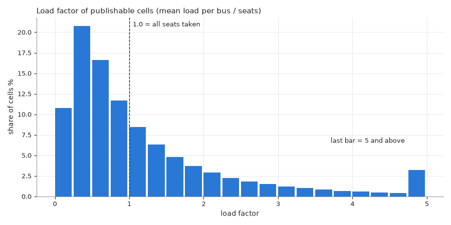

# CHECKS

Generated by `python -m seatcast.run checks` from `data/out/` and `data/work/`. Nothing here is typed by hand.

## 1. Coverage

| measure | value |
|---|---|
| ticket rows | 2,559,899 |
| passengers | 2,753,606 |
| days | 31 (20 weekdays, 5 Saturdays, 6 Sundays and holidays) |
| passengers on discounted standard slabs | 99.3% |
| passengers on NCR fares | 0.6% |
| rows with no vehicle number | 48.5% |
| route matched | 98.35% of passengers |
| both stops matched | 93.89% of routed passengers |
| board before alight | 99.78% of those |
| usable end to end | 92.09% of passengers |
| represented in flows (after imputing partial tickets) | 97.61% |
| agency split of usable passengers | DTC 77.97%, DIMTS 22.03% |

## 2. Expansion

D_daily (mean digital passengers per day) = 88,826. E low / central / high = 31.21 / 44.58 / 45.93.
Each ticket passenger stands for about 45 riders of the 3,960,000 per day in the central estimate (high 4,080,000); the file is 2.2% of that.

## 3. Weekday hourly profile

Morning peak 9:00 (14,327 passengers per day), evening peak 18:00 (9,902). Quietest midday hour 14:00 (2,575). Peak-to-midday ratio: morning 5.6, evening 3.8.

## 4. Daily totals by day type

| day type | days | mean passengers per day |
|---|---|---|
| weekday | 20 | 102,303 |
| saturday | 5 | 81,251 |
| sunday | 6 | 50,216 |

Weekday cells carry more flow than Sunday cells in 79.1% of the cells both day types share. Holidays count as Sundays.

## 5. Busiest corridors

Top 15 segments by weekday daily digital flow (before expansion).

| route | from | to | weekday digital flow/day | sampled pax-segments |
|---|---|---|---|---|
| 717AUP | Asian Market | Saket Crossing | 1,303 | 26,069 |
| 717AUP | Saket Crossing | Maidan Garhi Crossing (SDM Court) | 1,291 | 25,813 |
| 717AUP | DIPSAR ( Institute of Pharmacy) | Asian Market | 1,277 | 25,533 |
| 717AUP | Maidan Garhi Crossing (SDM Court) | Saket Metro Sation / Said-ul-Ajaib | 1,274 | 25,489 |
| 717AUP | Ambedkar Nagar Terminal / DIPSAR | DIPSAR ( Institute of Pharmacy) | 1,241 | 24,826 |
| 717AUP | Ambedkar Nagar Depot | Ambedkar Nagar Terminal / DIPSAR | 1,208 | 24,169 |
| 717AUP | Khanpur Extension / Devli Road Xing  / Dakshin Puri G-Block | Ambedkar Nagar Depot | 1,168 | 23,360 |
| 717AUP | VASANT KUNJ BUS STAND / Vasant Kunj Sec- B -1 | Masood Pur Village | 1,166 | 23,328 |
| 717AUP | Vasant Kunj SecD/34   /   Vasant Kunj Fortis | VASANT KUNJ BUS STAND / Vasant Kunj Sec- B -1 | 1,157 | 23,135 |
| 717ADOWN | Vasant Kunj SecD/34 | Kishan Garh | 1,155 | 23,098 |
| 717ADOWN | Saket Crossing | Asian Market | 1,151 | 23,015 |
| 717ADOWN | Mahipal Pur Village | Rang Puri Pahari | 1,150 | 23,007 |
| 717ADOWN | VASANT KUNJ BUS STAND / Vasant Kunj sec B-1 | Vasant Kunj SecD/34 | 1,148 | 22,955 |
| 717ADOWN | Masood Pur Dairy | Masood Pur Village | 1,148 | 22,952 |
| 717ADOWN | Asian Market | DIPSAR College of Pharmacy / Ambedkar Nagar (T.) | 1,147 | 22,949 |

## 6. Directional asymmetry

UP share of flow on the top 20 routes by weekday flow, morning window 7:00-10:00 against evening window 17:00-20:00. The heavier direction differs between the windows on 17 of 20 routes.

| route | UP share AM | UP share PM | heavier AM | heavier PM |
|---|---|---|---|---|
| 717A | 63% | 39% | UP | DOWN |
| 764 | 57% | 42% | UP | DOWN |
| 729 | 38% | 54% | DOWN | UP |
| 623 | 66% | 40% | UP | DOWN |
| 539 | 12% | 71% | DOWN | UP |
| 717B | 60% | 27% | UP | DOWN |
| 511A | 64% | 43% | UP | DOWN |
| 774 | 40% | 43% | DOWN | DOWN |
| 534 | 59% | 40% | UP | DOWN |
| 717 | 55% | 45% | UP | DOWN |
| 578 | 34% | 62% | DOWN | UP |
| 433 | 36% | 67% | DOWN | UP |
| 522 | 55% | 57% | UP | UP |
| 721 | 29% | 66% | DOWN | UP |
| 473 | 47% | 52% | DOWN | UP |
| 543A | 64% | 57% | UP | UP |
| 525STL | 57% | 39% | UP | DOWN |
| 85 | 61% | 42% | UP | DOWN |
| 544 | 24% | 61% | DOWN | UP |
| 448 | 28% | 57% | DOWN | UP |

## 7. Week-to-week stability

1684 route-directions have a rho. Median 0.55; 1135 (67%) are below the high-confidence threshold of 0.7. The 15 busiest unstable routes:

| route | rho | sampled pax-segments |
|---|---|---|
| 114UP | 0.68 | 102,757 |
| 254AUP | 0.63 | 101,169 |
| 794DOWN | 0.28 | 101,012 |
| 546DOWN | 0.69 | 97,906 |
| 991DOWN | 0.68 | 93,347 |
| 991UP | 0.69 | 89,696 |
| TMS(-)DOWN | 0.69 | 84,094 |
| 182AUP | 0.56 | 83,463 |
| 988DOWN | 0.46 | 83,213 |
| 181ADOWN | 0.62 | 82,869 |
| 546UP | 0.60 | 80,401 |
| YMSCW | 0.66 | 78,595 |
| 107UP | 0.58 | 77,060 |
| 929DOWN | 0.63 | 76,911 |
| 440ADOWN | 0.68 | 76,629 |

## 8. Anomalous days

Days flagged (beyond the configured deviation from the same-weekday median): none. Largest deviations:

| date | day type | passengers | deviation |
|---|---|---|---|
| 2026-10-18 | sunday | 40,103 | -21.8% |
| 2026-10-06 | weekday | 87,481 | -19.4% |
| 2026-10-19 | weekday | 80,945 | -19.2% |
| 2026-10-31 | saturday | 90,818 | +12.2% |
| 2026-10-25 | sunday | 56,767 | +10.6% |

## 9. Plausibility

Publishable cells: 2,312,450 of 4,411,005. Load factor p10 / p50 / p90 / p99 = 0.241 / 0.785 / 2.743 / 4.865.
Over seats: 40.19% of cells. Over total capacity: 22.94%. Censored at 3 x total capacity: 3.037% of cells (these show as the top load factor, which is the censor cap and explains the repeated top values below).

Routes with most censored cells:

| route | dir | censored cells | sampled pax-segments |
|---|---|---|---|
| 717A | UP | 1686 | 858,651 |
| 717 | DOWN | 1541 | 321,713 |
| 717 | UP | 1455 | 347,035 |
| 717A | DOWN | 1441 | 729,924 |
| 539 | DOWN | 1118 | 396,422 |
| 717B | DOWN | 1087 | 384,845 |
| 774 | DOWN | 831 | 315,947 |
| 774 | UP | 811 | 239,909 |
| 525 | DOWN | 798 | 165,581 |
| 525 | UP | 798 | 171,869 |

Ten most crowded route-hours by standee-minutes:

| route | day type | hour | standee-min | LF | sampled pax | stretch |
|---|---|---|---|---|---|---|
| 717ADOWN | saturday | 9 | 95,479 | 4.86 | 273 | Shiv Murti  2 (NH8) /  Dwarka Mor -> Mahipal Pur Village |
| 729DOWN | weekday | 8 | 93,058 | 4.86 | 1,288 | Uppal Hotel -> Shiv Murti (NH8) |
| 717ADOWN | weekday | 9 | 85,633 | 4.86 | 951 | Kathuria Public School/Vasant Kunj D7 -> Masood Pur Dairy |
| 729DOWN | saturday | 8 | 82,395 | 4.86 | 303 | Shiv Murti (NH8) -> Rang puri (NH8) |
| 717AUP | saturday | 8 | 81,880 | 4.86 | 369 | Saket Crossing -> Maidan Garhi Crossing (SDM Court) |
| 578DOWN | weekday | 8 | 81,430 | 4.86 | 803 | Check Post  /  Toll Tax Post -> Bamnoli Crossing |
| 717ADOWN | saturday | 8 | 80,990 | 4.86 | 229 | Samalkha Crossing -> Shiv Murti  2 (NH8) /  Dwarka Mor |
| 729DOWN | weekday | 9 | 78,437 | 4.86 | 875 | Uppal Hotel -> Shiv Murti (NH8) |
| 539DOWN | saturday | 9 | 75,764 | 4.86 | 142 | Jhatikara Crossing -> Rewla Taj Pur More |
| 539UP | weekday | 20 | 75,634 | 4.86 | 489 | Kapashera Village Bijwasan Road -> Shri Golok Dham Bijwasan School / Bijwason School |

## 10. Where estimates are weakest

- Low-n cells: 1,567,115 of 4,411,005 cells have fewer than 5 sampled passengers and are shown as limited data. Of the publishable cells, confidence is high 24.21%, medium 42.72%, low 33.07%.
- Schedule gaps: 531,440 cells carry passengers but no scheduled bus (2.62% of passengers).
- Hours with the highest low-confidence share: 0:00 (54%), 4:00 (53%), 3:00 (50%).

Ten worst-placed routes among the 100 busiest by passengers:

| route | passengers | placed in order |
|---|---|---|
| 425 | 10,707 | 66.5% |
| D-1103 | 8,963 | 69.4% |
| 578 | 32,010 | 77.7% |
| 718 | 7,515 | 78.2% |
| 978 | 12,268 | 79.9% |
| 539A | 8,797 | 80.1% |
| 835 | 7,493 | 80.5% |
| 949 | 7,794 | 80.9% |
| 523 | 15,861 | 80.9% |
| 708 | 9,966 | 81.5% |

Per hour of day, publishable cells:

| hour | cells | low confidence | mean sampled pax-segments |
|---|---|---|---|
| 0 | 1,579 | 54% | 13.5 |
| 1 | 1,562 | 46% | 19.0 |
| 2 | 1,341 | 48% | 18.1 |
| 3 | 1,703 | 50% | 13.4 |
| 4 | 5,451 | 53% | 16.0 |
| 5 | 33,300 | 42% | 22.8 |
| 6 | 83,900 | 36% | 28.7 |
| 7 | 136,634 | 32% | 40.5 |
| 8 | 184,646 | 29% | 62.2 |
| 9 | 197,538 | 28% | 69.9 |
| 10 | 174,937 | 29% | 51.1 |
| 11 | 143,194 | 32% | 33.8 |
| 12 | 118,150 | 36% | 26.5 |
| 13 | 100,359 | 38% | 23.3 |
| 14 | 97,212 | 39% | 22.7 |
| 15 | 103,892 | 37% | 24.7 |
| 16 | 121,198 | 35% | 28.7 |
| 17 | 147,804 | 33% | 37.7 |
| 18 | 164,966 | 31% | 49.0 |
| 19 | 159,177 | 31% | 51.5 |
| 20 | 140,121 | 32% | 44.0 |
| 21 | 107,800 | 34% | 34.2 |
| 22 | 63,962 | 39% | 25.6 |
| 23 | 22,024 | 49% | 17.8 |

## 11. GPS ground truth

Route check on 536,593 sampled pings: 64.6% within 200 m of a stop of their own route, against 2.3% for another route (median 137 m against 10,650 m).

Vehicle overlap on the 3 detail days: 99.3% of ticket passengers (with a known vehicle) rode a vehicle that is in the DTC GPS feed.

Where was the bus at purchase? 95,158 tickets matched to a ping (median lag 8 s). Distance to the matched boarding stop: median 218 m, 81% within 500 m. Distance to the alighting stop: median 4,308 m, 0.6% within 500 m.

| stop-match rule | tickets | median m | within 500 m |
|---|---|---|---|
| a | 65,948 | 209 | 82% |
| b | 1,091 | 186 | 88% |
| c | 11,351 | 219 | 80% |
| d | 9,809 | 247 | 77% |
| e | 4,197 | 268 | 74% |
| f | 2,762 | 294 | 73% |

Delivered service (observed bus-km against scheduled), all days of October:

| day type | days | delivered / scheduled | route-band q10/25/50/75/90 | share below 0.8 | vehicles pinged per day | riders per bus per day (central) |
|---|---|---|---|---|---|---|
| weekday | 20 | 0.62 | 0.35 / 0.52 / 0.72 / 0.90 / 1.06 | 61% | 6,197 | 639 |
| saturday | 5 | 0.629 | 0.48 / 0.62 / 0.78 / 0.93 / 1.05 | 53% | 6,174 | 641 |
| sunday | 6 | 0.662 | 0.46 / 0.62 / 0.79 / 0.95 / 1.06 | 51% | 6,061 | 653 |

## 12. The rejected calibration

| quantile | crush x total | routes over cap | their riders % | carried if cut % | max carried at cap % |
|---|---|---|---|---|---|
| 0.9 | 1.5 | 569 | 55.2 | 82.6 | 111.1 |
| 0.9 | 2.0 | 298 | 31.5 | 91.5 | 148.1 |
| 0.9 | 2.5 | 164 | 17.2 | 95.3 | 185.2 |
| 0.9 | 3.0 | 91 | 10.7 | 97.0 | 222.2 |
| 0.95 | 1.5 | 837 | 76.0 | 69.5 | 83.3 |
| 0.95 | 2.0 | 552 | 56.5 | 81.8 | 111.0 |
| 0.95 | 2.5 | 355 | 38.0 | 89.1 | 138.8 |
| 0.95 | 3.0 | 230 | 26.2 | 93.4 | 166.5 |

Scaling every over-capacity route down to capacity was analysed and not applied (calibration switch: False). Even the mildest setting (quantile 0.9, crush 3.0) flags 91 routes carrying 10.7% of riders, and the strictest (quantile 0.95, crush 1.5) flags 837 routes carrying 76.0%, which is too much of the network to treat as noise.
