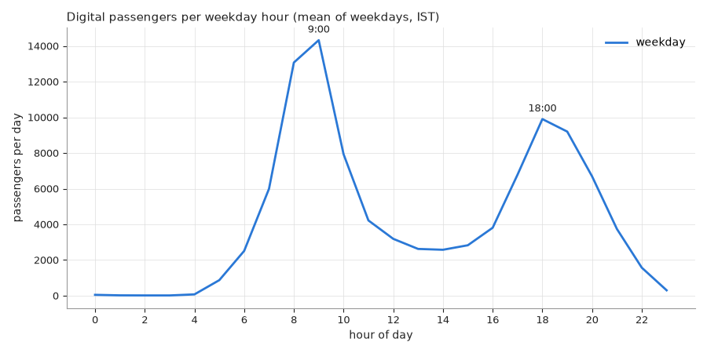
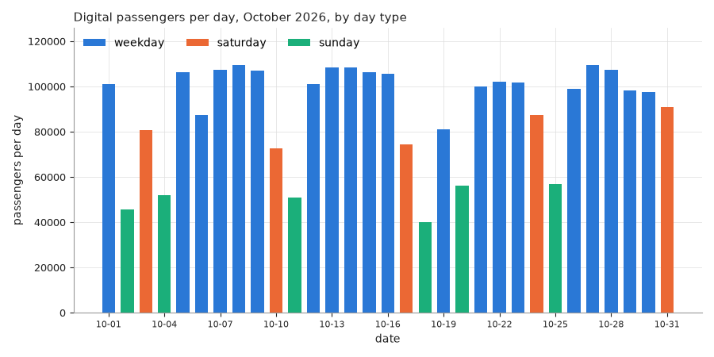
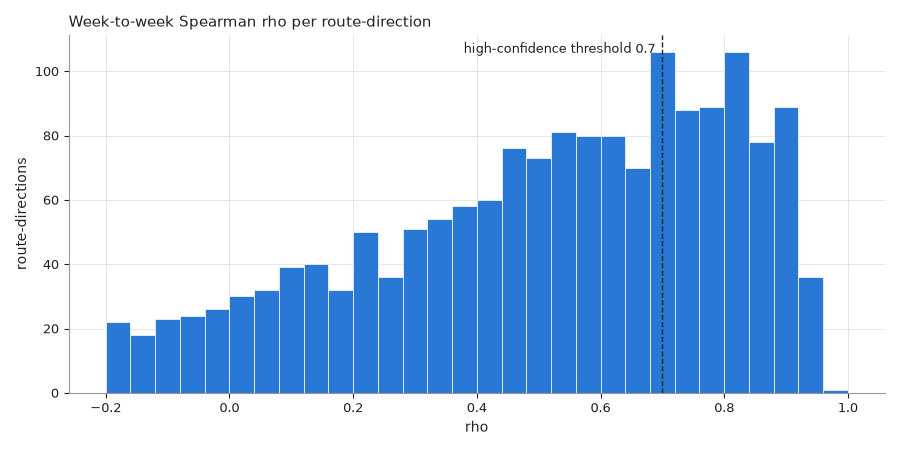

# CHECKS

Generated by `python -m seatcast.run checks` from `data/out/` and `data/work/`. Nothing here is typed by hand.

## 1. Coverage

| measure | value |
|---|---|
| ticket rows | 2,559,899 |
| passengers | 2,753,606 |
| days | 31 (20 weekdays, 5 Saturdays, 6 Sundays and holidays) |
| passengers on discounted standard slabs | 99.3% |
| passengers on NCR fares | 0.6% |
| rows with no vehicle number | 48.5% |
| route matched | 98.35% of passengers |
| both stops matched | 93.89% of routed passengers |
| board before alight | 99.78% of those |
| usable end to end | 92.09% of passengers |
| represented in flows (after imputing partial tickets) | 97.61% |
| agency split of usable passengers | DTC 77.97%, DIMTS 22.03% |

## 2. Expansion

D_daily (mean digital passengers per day) = 88,826. E low / central / high = 31.21 / 44.58 / 45.93.
Each ticket passenger stands for about 45 riders of the 3,960,000 per day in the central estimate (high 4,080,000); the file is 2.2% of that.

## 3. Weekday hourly profile

Morning peak 9:00 (14,327 passengers per day), evening peak 18:00 (9,902). Quietest midday hour 14:00 (2,575). Peak-to-midday ratio: morning 5.6, evening 3.8.

## 4. Daily totals by day type

| day type | days | mean passengers per day |
|---|---|---|
| weekday | 20 | 102,303 |
| saturday | 5 | 81,251 |
| sunday | 6 | 50,216 |

Weekday cells carry more flow than Sunday cells in 75.6% of the cells both day types share. Holidays count as Sundays.

## 5. Busiest corridors

Top 15 segments by weekday daily digital flow (before expansion).

| route | from | to | weekday digital flow/day | sampled pax-segments |
|---|---|---|---|---|
| 717AUP | Asian Market | Saket Crossing | 1,303 | 26,069 |
| 717AUP | Saket Crossing | Maidan Garhi Crossing (SDM Court) | 1,291 | 25,813 |
| 717AUP | DIPSAR ( Institute of Pharmacy) | Asian Market | 1,277 | 25,533 |
| 717AUP | Maidan Garhi Crossing (SDM Court) | Saket Metro Sation / Said-ul-Ajaib | 1,274 | 25,489 |
| 717AUP | Ambedkar Nagar Terminal / DIPSAR | DIPSAR ( Institute of Pharmacy) | 1,241 | 24,826 |
| 717AUP | Ambedkar Nagar Depot | Ambedkar Nagar Terminal / DIPSAR | 1,208 | 24,169 |
| 717AUP | Khanpur Extension / Devli Road Xing  / Dakshin Puri G-Block | Ambedkar Nagar Depot | 1,168 | 23,360 |
| 717AUP | VASANT KUNJ BUS STAND / Vasant Kunj Sec- B -1 | Masood Pur Village | 1,166 | 23,328 |
| 717AUP | Vasant Kunj SecD/34   /   Vasant Kunj Fortis | VASANT KUNJ BUS STAND / Vasant Kunj Sec- B -1 | 1,157 | 23,135 |
| 717ADOWN | Vasant Kunj SecD/34 | Kishan Garh | 1,155 | 23,098 |
| 717ADOWN | Saket Crossing | Asian Market | 1,151 | 23,015 |
| 717ADOWN | Mahipal Pur Village | Rang Puri Pahari | 1,150 | 23,007 |
| 717ADOWN | VASANT KUNJ BUS STAND / Vasant Kunj sec B-1 | Vasant Kunj SecD/34 | 1,148 | 22,955 |
| 717ADOWN | Masood Pur Dairy | Masood Pur Village | 1,148 | 22,952 |
| 717ADOWN | Asian Market | DIPSAR College of Pharmacy / Ambedkar Nagar (T.) | 1,147 | 22,949 |

## 6. Directional asymmetry

UP share of flow on the top 20 routes by weekday flow, morning window 7:00-10:00 against evening window 17:00-20:00. The heavier direction differs between the windows on 17 of 20 routes.

| route | UP share AM | UP share PM | heavier AM | heavier PM |
|---|---|---|---|---|
| 717A | 63% | 39% | UP | DOWN |
| 764 | 57% | 42% | UP | DOWN |
| 729 | 38% | 54% | DOWN | UP |
| 623 | 66% | 40% | UP | DOWN |
| 539 | 12% | 71% | DOWN | UP |
| 717B | 60% | 27% | UP | DOWN |
| 511A | 64% | 43% | UP | DOWN |
| 774 | 40% | 43% | DOWN | DOWN |
| 534 | 59% | 40% | UP | DOWN |
| 717 | 55% | 45% | UP | DOWN |
| 578 | 34% | 62% | DOWN | UP |
| 433 | 36% | 67% | DOWN | UP |
| 522 | 55% | 57% | UP | UP |
| 721 | 29% | 66% | DOWN | UP |
| 473 | 47% | 52% | DOWN | UP |
| 543A | 64% | 57% | UP | UP |
| 525STL | 57% | 39% | UP | DOWN |
| 85 | 61% | 42% | UP | DOWN |
| 544 | 24% | 61% | DOWN | UP |
| 448 | 28% | 57% | DOWN | UP |

## 7. Week-to-week stability

1684 route-directions have a rho. Median 0.55; 1135 (67%) are below the high-confidence threshold of 0.7. The 15 busiest unstable routes:

| route | rho | sampled pax-segments |
|---|---|---|
| 114UP | 0.68 | 102,757 |
| 254AUP | 0.63 | 101,169 |
| 794DOWN | 0.28 | 101,012 |
| 546DOWN | 0.69 | 97,906 |
| 991DOWN | 0.68 | 93,347 |
| 991UP | 0.69 | 89,696 |
| TMS(-)DOWN | 0.69 | 84,094 |
| 182AUP | 0.56 | 83,463 |
| 988DOWN | 0.46 | 83,213 |
| 181ADOWN | 0.62 | 82,869 |
| 546UP | 0.60 | 80,401 |
| YMSCW | 0.66 | 78,595 |
| 107UP | 0.58 | 77,060 |
| 929DOWN | 0.63 | 76,911 |
| 440ADOWN | 0.68 | 76,629 |

## 8. Anomalous days

Days flagged (beyond the configured deviation from the same-weekday median): none. Largest deviations:

| date | day type | passengers | deviation |
|---|---|---|---|
| 2026-10-18 | sunday | 40,103 | -21.8% |
| 2026-10-06 | weekday | 87,481 | -19.4% |
| 2026-10-19 | weekday | 80,945 | -19.2% |
| 2026-10-31 | saturday | 90,818 | +12.2% |
| 2026-10-25 | sunday | 56,767 | +10.6% |

## 9. Plausibility

Publishable cells: 2,312,451 of 4,411,005. Load factor p10 / p50 / p90 / p99 = 0.241 / 0.785 / 2.427 / 2.432.
Over seats: 40.19% of cells. Over total capacity: 22.94%. Censored at 1.5 x total capacity: 12.338% of cells (these show as the top load factor, which is the censor cap and explains the repeated top values below).

Routes with most censored cells:

| route | dir | censored cells | sampled pax-segments |
|---|---|---|---|
| 717A | UP | 4184 | 1,265,266 |
| 717A | DOWN | 3131 | 1,018,869 |
| 717 | UP | 3123 | 493,728 |
| 717 | DOWN | 3087 | 442,655 |
| 717B | DOWN | 2861 | 572,458 |
| 539 | UP | 2330 | 447,017 |
| 706 | DOWN | 2262 | 257,397 |
| 539 | DOWN | 1970 | 505,392 |
| 774 | DOWN | 1954 | 436,957 |
| 717B | UP | 1890 | 413,987 |

Ten most crowded route-hours by standee-minutes:

| route | day type | hour | standee-min | LF | sampled pax | stretch |
|---|---|---|---|---|---|---|
| 729DOWN | weekday | 8 | 41,823 | 2.43 | 1,288 | Uppal Hotel -> Shiv Murti (NH8) |
| 717ADOWN | sunday | 9 | 41,053 | 2.43 | 199 | VASANT KUNJ BUS STAND / Vasant Kunj sec B-1 -> Vasant Kunj SecD/34 |
| 729DOWN | saturday | 8 | 41,028 | 2.43 | 303 | Shiv Murti (NH8) -> Rang puri (NH8) |
| 717ADOWN | saturday | 9 | 39,676 | 2.43 | 273 | Shiv Murti  2 (NH8) /  Dwarka Mor -> Mahipal Pur Village |
| 729UP | weekday | 9 | 38,895 | 2.43 | 772 | Shiv Murti -> Rajokari Xing |
| 729DOWN | sunday | 10 | 38,255 | 2.43 | 189 | Mahipal Pur (NH8) / MAHIPAL PUR CROSSING -> Shankar Vihar NH8 / Shankar Vihar |
| 729UP | weekday | 8 | 37,894 | 2.43 | 586 | Shiv Murti -> Rajokari Xing |
| 764DOWN | weekday | 9 | 37,514 | 2.43 | 572 | RK Puram Sec 6 -> Swami Malai Mandir |
| 729DOWN | sunday | 8 | 37,400 | 2.43 | 262 | Shiv Murti (NH8) -> Rang puri (NH8) |
| 729DOWN | weekday | 9 | 37,328 | 2.43 | 875 | Uppal Hotel -> Shiv Murti (NH8) |

## 10. Where estimates are weakest

- Low-n cells: 1,567,114 of 4,411,005 cells have fewer than 5 sampled passengers and are shown as limited data. Of the publishable cells, confidence is high 26.34%, medium 43.62%, low 30.04%.
- Schedule gaps: 531,440 cells carry passengers but no scheduled bus (2.62% of passengers).
- Hours with the highest low-confidence share: 0:00 (54%), 4:00 (52%), 3:00 (50%).

Ten worst-placed routes among the 100 busiest by passengers:

| route | passengers | placed in order |
|---|---|---|
| 425 | 10,707 | 66.5% |
| D-1103 | 8,963 | 69.4% |
| 578 | 32,010 | 77.7% |
| 718 | 7,515 | 78.2% |
| 978 | 12,268 | 79.9% |
| 539A | 8,797 | 80.1% |
| 835 | 7,493 | 80.5% |
| 949 | 7,794 | 80.9% |
| 523 | 15,861 | 80.9% |
| 708 | 9,966 | 81.5% |

Per hour of day, publishable cells:

| hour | cells | low confidence | mean sampled pax-segments |
|---|---|---|---|
| 0 | 1,579 | 54% | 13.5 |
| 1 | 1,562 | 46% | 19.0 |
| 2 | 1,341 | 48% | 18.1 |
| 3 | 1,703 | 50% | 13.4 |
| 4 | 5,450 | 52% | 16.0 |
| 5 | 33,300 | 41% | 22.8 |
| 6 | 83,900 | 35% | 28.7 |
| 7 | 136,635 | 30% | 40.5 |
| 8 | 184,646 | 24% | 62.2 |
| 9 | 197,539 | 21% | 69.9 |
| 10 | 174,937 | 25% | 51.1 |
| 11 | 143,194 | 31% | 33.8 |
| 12 | 118,150 | 35% | 26.5 |
| 13 | 100,358 | 37% | 23.3 |
| 14 | 97,212 | 38% | 22.7 |
| 15 | 103,892 | 37% | 24.7 |
| 16 | 121,198 | 34% | 28.7 |
| 17 | 147,804 | 30% | 37.7 |
| 18 | 164,965 | 27% | 49.0 |
| 19 | 159,178 | 25% | 51.5 |
| 20 | 140,122 | 28% | 44.0 |
| 21 | 107,799 | 32% | 34.2 |
| 22 | 63,963 | 37% | 25.6 |
| 23 | 22,024 | 47% | 17.8 |

## 11. GPS ground truth

Route check on 536,593 sampled pings: 64.6% within 200 m of a stop of their own route, against 2.3% for another route (median 137 m against 10,650 m).

Vehicle overlap on the 3 detail days: 99.3% of ticket passengers (with a known vehicle) rode a vehicle that is in the DTC GPS feed.

Where was the bus at purchase? 95,158 tickets matched to a ping (median lag 8 s). Distance to the matched boarding stop: median 218 m, 81% within 500 m. Distance to the alighting stop: median 4,308 m, 0.6% within 500 m.

| stop-match rule | tickets | median m | within 500 m |
|---|---|---|---|
| a | 65,948 | 209 | 82% |
| b | 1,091 | 186 | 88% |
| c | 11,351 | 219 | 80% |
| d | 9,809 | 247 | 77% |
| e | 4,197 | 268 | 74% |
| f | 2,762 | 294 | 73% |

Delivered service (observed bus-km against scheduled), all days of October:

| day type | days | delivered / scheduled | route-band q10/25/50/75/90 | share below 0.8 | vehicles pinged per day | riders per bus per day (central) |
|---|---|---|---|---|---|---|
| weekday | 20 | 0.62 | 0.35 / 0.52 / 0.72 / 0.90 / 1.06 | 61% | 6,197 | 639 |
| saturday | 5 | 0.629 | 0.48 / 0.62 / 0.78 / 0.93 / 1.05 | 53% | 6,174 | 641 |
| sunday | 6 | 0.662 | 0.46 / 0.62 / 0.79 / 0.95 / 1.06 | 51% | 6,061 | 653 |

## 12. The rejected calibration

| quantile | crush x total | routes over cap | their riders % | carried if cut % | max carried at cap % |
|---|---|---|---|---|---|
| 0.9 | 1.5 | 569 | 55.2 | 82.6 | 111.1 |
| 0.9 | 2.0 | 298 | 31.5 | 91.5 | 148.1 |
| 0.9 | 2.5 | 164 | 17.2 | 95.3 | 185.2 |
| 0.9 | 3.0 | 91 | 10.7 | 97.0 | 222.2 |
| 0.95 | 1.5 | 837 | 76.0 | 69.5 | 83.3 |
| 0.95 | 2.0 | 552 | 56.5 | 81.8 | 111.0 |
| 0.95 | 2.5 | 355 | 38.0 | 89.1 | 138.8 |
| 0.95 | 3.0 | 230 | 26.2 | 93.4 | 166.5 |

Scaling every over-capacity route down to capacity was analysed and not applied (calibration switch: False). Even the mildest setting (quantile 0.9, crush 3.0) flags 91 routes carrying 10.7% of riders, and the strictest (quantile 0.95, crush 1.5) flags 837 routes carrying 76.0%, which is too much of the network to treat as noise.

## 13. Output plausibility

Published cells (flag none), weekday unless stated. Mean load per observed bus is the published load (censored at 1.5 x total); the raw column is uncensored.

| hour | cells | mean load per observed bus | mean raw load | crushed share |
|---|---|---|---|---|
| 0 | 1,023 | 25.9 | 26.3 | 10.3% |
| 1 | 909 | 31.6 | 33.0 | 16.7% |
| 2 | 733 | 25.9 | 26.1 | 5.9% |
| 3 | 913 | 22.1 | 22.1 | 2.6% |
| 4 | 3,150 | 29.7 | 32.5 | 12.2% |
| 5 | 17,842 | 29.1 | 32.3 | 13.4% |
| 6 | 42,508 | 29.6 | 32.9 | 14.5% |
| 7 | 67,750 | 37.9 | 46.9 | 23.9% |
| 8 | 86,446 | 49.8 | 72.4 | 38.6% |
| 9 | 88,824 | 54.3 | 81.8 | 44.7% |
| 10 | 80,234 | 46.9 | 62.3 | 34.1% |
| 11 | 69,068 | 33.2 | 37.4 | 16.2% |
| 12 | 59,757 | 26.2 | 28.4 | 9.6% |
| 13 | 51,674 | 25.2 | 27.1 | 8.6% |
| 14 | 50,276 | 25.0 | 27.1 | 8.4% |
| 15 | 53,087 | 25.4 | 27.2 | 9.5% |
| 16 | 61,029 | 27.9 | 30.6 | 12.0% |
| 17 | 72,627 | 38.2 | 47.8 | 23.5% |
| 18 | 78,790 | 49.2 | 69.7 | 37.6% |
| 19 | 75,665 | 51.5 | 77.3 | 40.8% |
| 20 | 67,722 | 42.5 | 56.9 | 28.3% |
| 21 | 53,827 | 35.6 | 42.3 | 19.9% |
| 22 | 33,702 | 29.8 | 34.0 | 14.1% |
| 23 | 12,650 | 26.5 | 29.3 | 10.3% |

Crushed share by weekday cell flow quartile (f = digital passengers per day on the segment and slot):

| quartile | f from | f to | cells | crushed share | low confidence |
|---|---|---|---|---|---|
| 1 | 0.25 | 0.60 | 282,552 | 0.7% | 75.0% |
| 2 | 0.60 | 1.40 | 282,552 | 8.8% | 0.2% |
| 3 | 1.40 | 3.45 | 282,551 | 25.7% | 0.0% |
| 4 | 3.45 | 122.25 | 282,551 | 63.0% | 0.0% |

Of 2,312,451 published cells, 12.3% have raw load above 1.5 x total capacity and 7.3% above 2 x. 11.6% have fewer than one observed bus in the slot window (N_obs < 1). Censored cells: 12.3%; low confidence overall: 30.0%.

## 14. Published-level stability

Level recomputed from week 1 and week 2 weekday flow (same N_obs, capacity and E) and compared per cell. The odd-versus-even-days split of the same two weeks is the ceiling: it has no week effect, only sampling noise.

| comparison | confidence | cells | same level | within one level |
|---|---|---|---|---|
| week 1 vs week 2 | all | 1,123,195 | 58.8% | 89.1% |
| week 1 vs week 2 | low | 205,927 | 63.8% | 88.7% |
| week 1 vs week 2 | medium | 496,455 | 51.9% | 84.4% |
| week 1 vs week 2 | high | 420,813 | 64.5% | 95.0% |
| odd vs even days (ceiling) | all | 1,123,195 | 62.5% | 92.4% |
| odd vs even days (ceiling) | low | 205,927 | 65.8% | 90.7% |
| odd vs even days (ceiling) | high | 420,813 | 67.8% | 96.6% |
| odd vs even days (ceiling) | medium | 496,455 | 56.7% | 89.5% |

Unstable routes: 794DOWN has rho 0.28 against the 0.7 threshold, so it is unstable (rank 3 by sampled passengers among the unstable routes).

## 15. Hold-out: weeks 1-3 predict week 4

The published level is rebuilt from the flow of weeks 1-3 only (21 days after dropping anomaly days), with the same N_obs, capacity, calibration and E as the published model, and compared per cell with the level from week 4 alone (6 days, 26-31 Oct). Cells need at least 5 sampled passengers on each side. The noise ceiling splits weeks 1-3 into two halves of days (alternating days within each day type) and compares the halves the same way, so it shows what sampling noise alone allows; each half has less data than weeks 1-3, so the ceiling is conservative.

| cells | n cells | same level | within one level | ceiling n cells | ceiling same | ceiling within one |
|---|---|---|---|---|---|---|
| all cells | 858,886 | 64.9% | 95.0% | 1,011,799 | 67.0% | 97.0% |
| high-confidence cells | 516,850 | 71.1% | 97.9% | 589,281 | 69.6% | 97.3% |

Crushed against not crushed (all cells, 858,886 cells):

| predicted from weeks 1-3 / observed in week 4 | crushed | not crushed |
|---|---|---|
| crushed | 301,305 | 42,407 |
| not crushed | 89,802 | 425,372 |

## 16. Sensitivity: how robust are the published levels

Each scenario is compared with the published level; expansion scenarios use the existing low/high levels, while capacity scenarios recompute with both seats and total capacity changed by the configured ±15%. The timetable scenario uses L × N_obs / N_sched and excludes cells with N_sched ≤ 0. “Moves to/from crushed” is the share that changes between crushed and not crushed. High confidence uses the existing confidence labels.

| scenario | group | cells | same level | within one level | moves to/from crushed |
|---|---|---|---|---|---|
| Expansion low | All published | 2,312,451 | 62.7% | 100.0% | 9.6% |
| Expansion low | High confidence | 609,100 | 57.5% | 100.0% | 16.5% |
| Expansion high | All published | 2,312,451 | 96.7% | 100.0% | 1.0% |
| Expansion high | High confidence | 609,100 | 96.7% | 100.0% | 1.5% |
| Capacity -15% | All published | 2,312,451 | 82.1% | 100.0% | 5.4% |
| Capacity -15% | High confidence | 609,100 | 82.7% | 100.0% | 8.0% |
| Capacity +15% | All published | 2,312,451 | 84.9% | 100.0% | 4.1% |
| Capacity +15% | High confidence | 609,100 | 84.0% | 100.0% | 6.7% |
| Timetable buses | All published | 2,312,451 | 59.9% | 94.9% | 14.0% |
| Timetable buses | High confidence | 609,100 | 47.8% | 93.3% | 27.4% |

By exact-level agreement across all published cells, the most robust scenario is Expansion high (96.7%) and the least robust is Timetable buses (59.9%).

## 17. Bus-to-bus variation, measured from GPS headways

The load of a bus is proportional to the gap since the bus before it (riders accumulate while they wait), so the variation of loads from bus to bus equals the variation of headways. For each route we found the buses passing two reference stops (GPS pings within 150 m) on all 14,772 route-day-type-bands, took the gaps between consecutive buses, and computed their coefficient of variation (CV) per day, stop and hour band, pooled with degrees-of-freedom weights. The timetable has irregular gaps of its own, so its CV at the same stops is removed in quadrature; what remains is the unscheduled irregularity (bunching and delay). Route-bands with few headways shrink to the network median (0.62). Seat chances now use the variation measured from GPS headways; the former assumption was 0.35.

| day type | hour band | route-bands | timetable CV | observed CV | unscheduled CV (median) | 25th pct | 75th pct |
|---|---|---|---|---|---|---|---|
| saturday | 00:00 | 400 | 0.46 | 0.80 | 0.62 | 0.42 | 0.77 |
| saturday | 07:00 | 1,024 | 0.46 | 0.78 | 0.60 | 0.40 | 0.76 |
| saturday | 10:00 | 1,438 | 0.58 | 0.79 | 0.53 | 0.22 | 0.71 |
| saturday | 17:00 | 951 | 0.48 | 0.91 | 0.72 | 0.51 | 0.89 |
| saturday | 20:00 | 954 | 0.50 | 0.88 | 0.69 | 0.49 | 0.85 |
| sunday | 00:00 | 403 | 0.46 | 0.80 | 0.61 | 0.43 | 0.77 |
| sunday | 07:00 | 1,021 | 0.46 | 0.77 | 0.58 | 0.40 | 0.73 |
| sunday | 10:00 | 1,428 | 0.58 | 0.78 | 0.50 | 0.20 | 0.69 |
| sunday | 17:00 | 989 | 0.49 | 0.88 | 0.68 | 0.49 | 0.85 |
| sunday | 20:00 | 970 | 0.50 | 0.85 | 0.66 | 0.47 | 0.81 |
| weekday | 00:00 | 457 | 0.44 | 0.80 | 0.61 | 0.44 | 0.78 |
| weekday | 07:00 | 1,086 | 0.45 | 0.79 | 0.62 | 0.43 | 0.76 |
| weekday | 10:00 | 1,522 | 0.57 | 0.80 | 0.54 | 0.31 | 0.72 |
| weekday | 17:00 | 1,055 | 0.48 | 0.89 | 0.73 | 0.52 | 0.87 |
| weekday | 20:00 | 1,074 | 0.48 | 0.88 | 0.69 | 0.51 | 0.84 |

Effect on the published seat chances (2,312,451 cells): the median P(seat) moves from 0.78 (assumed 0.35) to 0.77; the "seats on k of 10 trips" figure changes in 43.6% of cells, by one or fewer in 88.9%, and the mean absolute change in P(seat) is 0.056. Crowding levels do not change, because they come from the mean load, not its spread.

One bias runs upward. A bus whose pass the GPS misses merges two gaps into one long one and inflates the CV. Simulated headways with a known CV, with a share of passes dropped:

| true CV | no pass missed | 5% missed | 10% missed | 15% missed |
|---|---|---|---|---|
| 0.35 | 0.35 | 0.40 | 0.44 | 0.48 |
| 0.50 | 0.50 | 0.53 | 0.56 | 0.59 |
| 0.60 | 0.60 | 0.62 | 0.64 | 0.65 |

Ticket matching found a GPS ping within 60 s for 87% of tickets (§11), so a few percent of passes may be missing and the measured median above probably overstates the true one by a few hundredths. We report this as a sensitivity and do not correct for it; either way the unscheduled variation is well above the 0.35 we had assumed.
