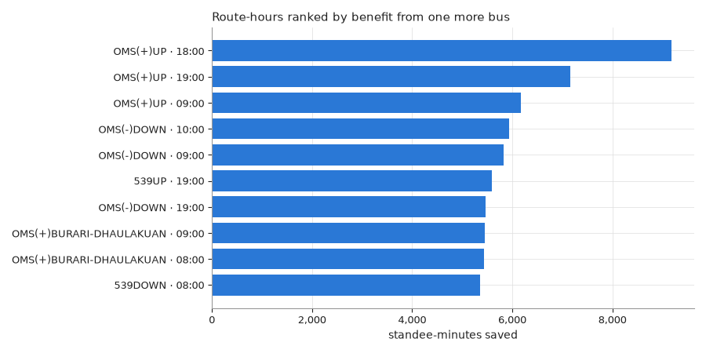
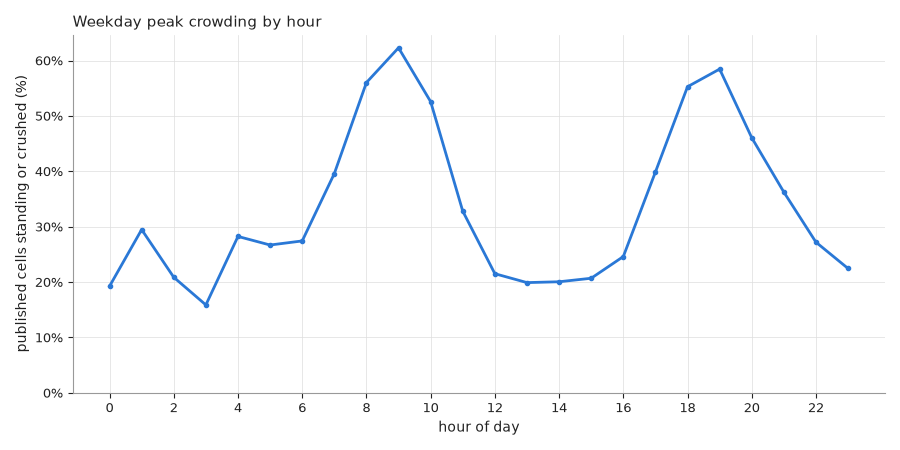

# Operator Findings

## Finding F1 — Where one more bus helps most

The highest +1-bus benefit is on OMS(+)UP at 18:00, where DDA Kalkaji Extension / Kalkaji Extension Pocket A-13 to Tughlaqabad Extn ran 1.6 buses/hour against 3 needed.

| Route | Hour | Busiest stretch | Ran → needed (buses/hour) | +1-bus benefit (standee-minutes) |
|---|---:|---|---:|---:|
| OMS(+)UP | 18:00 | DDA Kalkaji Extension / Kalkaji Extension Pocket A-13 → Tughlaqabad Extn | 1.6 → 3 | 9,175.4 |
| OMS(+)UP | 19:00 | Guru Ravidass Marg / Guru Ravi Das Ashram / Tughlaqabad Extension → Majeedia Hospital | 1.6 → 3 | 7,157.6 |
| OMS(+)UP | 09:00 | Munirka Famliy Planing → Munirka Village (T) | 1.9 → 4 | 6,170.0 |
| OMS(-)DOWN | 10:00 | Crown Plaza → CLal Chowk | 3.8 → 8 | 5,934.8 |
| OMS(-)DOWN | 09:00 | Crown Plaza → CLal Chowk | 2.8 → 6 | 5,831.1 |
| 539UP | 19:00 | Jhatikara Crossing → Goyla Dairy Crossing | 2.5 → 5 | 5,586.8 |
| OMS(-)DOWN | 19:00 | DIPSAR College of Pharmacy / Ambedkar Nagar (T.) → Ambedkar Nagar Terminal | 2.1 → 4 | 5,470.3 |
| OMS(+)BURARI-DHAULAKUAN | 09:00 | Shahdara Border Seemapuri Road → Surya Nagar (Gazipur Road) | 2.5 → 5 | 5,453.3 |
| OMS(+)BURARI-DHAULAKUAN | 08:00 | Ram Prastha Temple → Ram Prastha Crossing | 4.1 → 8 | 5,432.0 |
| 539DOWN | 08:00 | Sumesh Vihar → BSF Camp Chhawla | 3.6 → 7 | 5,358.5 |

## Finding F2 — Weekday peak service shortfall

Observed service falls short in 2,718 morning and 2,607 evening route-hours, with summed shortfalls of 4,903.6 and 3,876.2 bus-hours, respectively.

| Peak | Summed shortfall (bus-hours) | Short route-hours |
|---|---:|---:|
| Morning | 4,903.6 | 2,718 |
| Evening | 3,876.2 | 2,607 |

## Finding F3 — Busiest passenger stretches

The busiest estimated weekday stretch is 717A UP, Asian Market → Saket Crossing, at 19,376 riders/day (using expansion factor E = 44.58).

| Base | Direction | From → to | Estimated riders/day |
|---|---|---|---:|
| 717A | UP | Asian Market → Saket Crossing | 19,376 |
| 717A | UP | Saket Crossing → Maidan Garhi Crossing (SDM Court) | 19,186 |
| 717A | UP | DIPSAR ( Institute of Pharmacy) → Asian Market | 18,977 |
| 717A | UP | Maidan Garhi Crossing (SDM Court) → Saket Metro Sation / Said-ul-Ajaib | 18,947 |
| 717A | UP | Ambedkar Nagar Terminal / DIPSAR → DIPSAR ( Institute of Pharmacy) | 18,450 |
| 717A | UP | Ambedkar Nagar Depot → Ambedkar Nagar Terminal / DIPSAR | 17,961 |
| 717A | UP | Khanpur Extension / Devli Road Xing  / Dakshin Puri G-Block → Ambedkar Nagar Depot | 17,364 |
| 717A | UP | VASANT KUNJ BUS STAND / Vasant Kunj Sec- B -1 → Masood Pur Village | 17,350 |
| 717A | UP | Vasant Kunj SecD/34   /   Vasant Kunj Fortis → VASANT KUNJ BUS STAND / Vasant Kunj Sec- B -1 | 17,210 |
| 717A | DOWN | Vasant Kunj SecD/34 → Kishan Garh | 17,170 |

## Finding F4 — Crowded share by hour

The highest weekday hourly crowded share is 62.3% at 09:00 (55,338 of 88,824 published cells).

| Hour | Published cells | Standing or crushed | Share |
|---:|---:|---:|---:|
| 00:00 | 1,023 | 197 | 19.3% |
| 01:00 | 909 | 268 | 29.5% |
| 02:00 | 733 | 153 | 20.9% |
| 03:00 | 913 | 145 | 15.9% |
| 04:00 | 3,151 | 890 | 28.2% |
| 05:00 | 17,842 | 4,763 | 26.7% |
| 06:00 | 42,508 | 11,661 | 27.4% |
| 07:00 | 67,750 | 26,821 | 39.6% |
| 08:00 | 86,446 | 48,428 | 56.0% |
| 09:00 | 88,824 | 55,338 | 62.3% |
| 10:00 | 80,234 | 42,184 | 52.6% |
| 11:00 | 69,068 | 22,662 | 32.8% |
| 12:00 | 59,757 | 12,858 | 21.5% |
| 13:00 | 51,674 | 10,288 | 19.9% |
| 14:00 | 50,275 | 10,086 | 20.1% |
| 15:00 | 53,087 | 10,987 | 20.7% |
| 16:00 | 61,029 | 15,021 | 24.6% |
| 17:00 | 72,627 | 28,957 | 39.9% |
| 18:00 | 78,790 | 43,548 | 55.3% |
| 19:00 | 75,665 | 44,232 | 58.5% |
| 20:00 | 67,722 | 31,198 | 46.1% |
| 21:00 | 53,827 | 19,510 | 36.2% |
| 22:00 | 33,702 | 9,169 | 27.2% |
| 23:00 | 12,650 | 2,841 | 22.5% |

## Finding F5 — Routes most often crushed in peak cells

Among routes with at least 20 published peak cells, 610SPL DOWN had the highest crushed share: 100.0% (40 of 40 cells).

| Base | Direction | Published peak cells | Crushed cells | Crushed share |
|---|---|---:|---:|---:|
| 610SPL | DOWN | 40 | 40 | 100.0% |
| 717A | UP | 612 | 611 | 99.8% |
| 717A | DOWN | 540 | 539 | 99.8% |
| 770ALTD | DOWN | 149 | 148 | 99.3% |
| 729 | DOWN | 540 | 532 | 98.5% |
| 774 | UP | 562 | 549 | 97.7% |
| 569EXT | DOWN | 116 | 113 | 97.4% |
| 770ALTD | UP | 157 | 152 | 96.8% |
| 717B | UP | 492 | 476 | 96.7% |
| 717E | DOWN | 204 | 197 | 96.6% |

Caveat: sizes at the peak carry the uncertainty described in TECH_NOTE §8; the ranking is the robust part.

## Outside check

The one public source we found with a route-level passenger pattern is a Down To Earth report on a DTC experiment on the TMS ring route, which it calls "one of the most popular bus routes in Delhi". An on-bus passenger count showed that on the up direction Maharani Bagh and Lajpat Nagar are high boarding stops, that "the passenger count dropped by half at the AIIMS stop", and that it "started to increase again after Dhaula Kuan".

SeatCast's weekday flow on TMS(+) UP has the same shape. It rises from 321 to 1,521 riders/day at Maharani Bagh, peaks at AIIMS (2,261), falls to a low of 1,478 at Satya Niketan (-35%), then rises again to 1,745 within six stretches of Dhaula Kuan (+18% from the low). The direction and stops broadly agree; the published drop is larger, and the two measure different things: the survey counted riders on board, we count app tickets scaled to all riders (E = 44.58).

| Stretch starts at | Order on route | Estimated weekday riders/day |
|---|---:|---:|
| Maharani Bagh | 2 | 1,521 |
| Lajpat Nagar Ring Road / VINOBA PURI METRO STATAION | 5 | 1,987 |
| AIIMS | 10 | 2,261 |
| Satya Niketan | 17 | 1,478 |
| ARSD College ( Dhaula Kuan) | 18 | 1,597 |
| COD Ring Road | 23 | 1,745 |

**Top-ten overlap:** not computable. Neither that report nor the GNCTD route-rationalization notice publishes a ranking of routes by ridership, and we do not substitute our own.

Sources: [Down To Earth, DTC route-curtailment pilot](https://www.downtoearth.org.in/energy/dtc-pilots-one-bus-route-design-to-demonstrate-improved-services-and-passengers); [GNCTD Transport Department, route-rationalization public notice](https://transport.delhi.gov.in/sites/default/files/Transport/circulars-orders/public_notice_route_rationalization.pdf).
